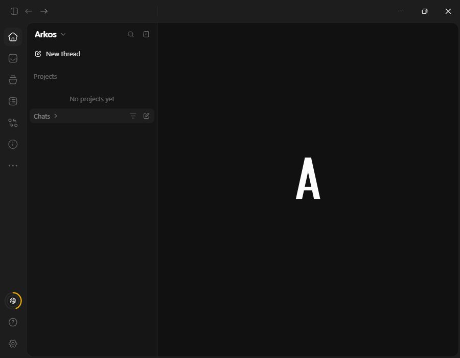
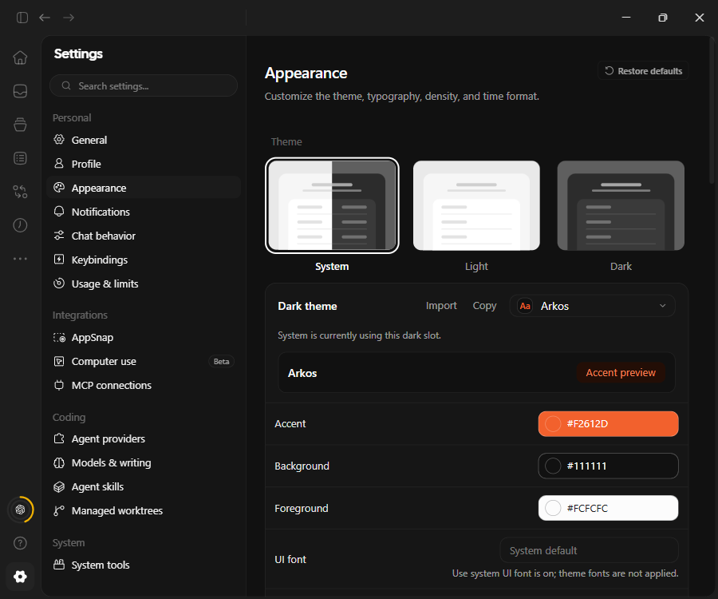

<div align="center">
  
  <h1>Arkos</h1>
  <p><strong>A focused workspace for coding agents.</strong><br>
  Projects, provider sessions, execution surfaces, and review tools in one local-first desktop application.</p>
</div>

| Workspace layer      | Responsibility                                                |
| -------------------- | ------------------------------------------------------------- |
| **Project**          | Repository context, settings, and related work.               |
| **Thread**           | Task-specific conversation, state, files, and history.        |
| **Provider session** | The authenticated coding-agent runtime executing the task.    |
| **Workspace tools**  | Changes, terminal, browser, files, editor, previews, and Git. |

> [!NOTE]
> Arkos is early-stage software. APIs and interface details remain under active development.

## Capabilities

### 1. Projects, threads, and context

Organize work around projects and threads. Projects define the workspace; threads preserve the task-specific conversation, state, files, and history.

- Project-aware navigation and conversations
- Provider and model selection per task
- Thread history, status, recaps, notes, and side chats
- Search and quick access across active work

### 2. Integrated workspace tools

The tools surrounding an agent session remain available from the same task surface, keeping execution and review connected.

| Surface            | Purpose                                                                                           |
| ------------------ | ------------------------------------------------------------------------------------------------- |
| **Changes**        | Inspect diffs, changed files, and review state.                                                   |
| **Terminal**       | Run commands in the project environment.                                                          |
| **Browser**        | Keep local previews next to the thread and let agents use semantic or page-declared WebMCP tools. |
| **Files / Editor** | Browse, inspect, and edit project files in context.                                               |
| **Git**            | Work with branches, commits, pushes, and pull requests.                                           |

### 3. Split views and previews

Keep an active conversation alongside the surface it is changing. Split views, browser previews, and device previews make the result part of the working context.

<p align="center">
  
</p>

### 4. Provider-native integrations

Arkos connects to coding-agent runtimes that are installed and authenticated locally. The current development build includes the following integrations:

| Runtime         | Local integration                           |
| --------------- | ------------------------------------------- |
| **Codex**       | Codex CLI / app-server                      |
| **Claude**      | Claude Code                                 |
| **Cursor**      | Cursor agent runtime                        |
| **Antigravity** | Antigravity CLI                             |
| **Grok**        | Grok Build                                  |
| **Droid**       | Factory Droid                               |
| **OpenCode**    | OpenCode and its configured model providers |
| **Pi**          | Pi and its configured model providers       |
| **Devin**       | Devin CLI                                   |

### 5. Isolated parallel work

Managed worktrees provide a boundary for parallel changes. Handoffs preserve project context when a task needs to continue with another provider or toolchain.

- Run work in a local checkout or an isolated managed worktree
- Keep parallel threads from modifying the same checkout unintentionally
- Hand off a task without losing its project context
- Review the resulting diff before it leaves the workspace

### 6. Automations and external MCP

Automations support recurring agent runs and keep their outcomes attached to projects and threads. External MCP integrations provide scoped, user-approved access for other local clients.


### 7. Appearance and workspace preferences

Configure the shell to match the way you work with light and dark themes, typography controls, density preferences, and workspace settings.

<p align="center">
  
</p>

### Additional capabilities

| Workflow          | Included surfaces                                               |
| ----------------- | --------------------------------------------------------------- |
| **Workspace**     | Local projects, chats, history, and multiple provider runtimes. |
| **Execution**     | Terminals, browser previews, files, and editor.                 |
| **Delivery**      | Diffs, Git actions, managed worktrees, and pull requests.       |
| **Orchestration** | Provider handoffs, automations, and scoped external MCP.        |
| **Development**   | Desktop shell plus focused server and web modes.                |

## Running locally

### Desktop application

Run the Electron app directly from source for development; no desktop installer is required. See
the development commands below.

This checkout does not produce or distribute installers. Windows x64, macOS Intel, macOS Apple
Silicon, and Linux x64 are the supported development hosts.

Workspace Git features require [Git 2.29 or newer](https://github.com/git/git/blob/v2.29.0/Documentation/RelNotes/2.29.0.txt). Background refreshes preserve the FETCH_HEAD used by explicit fetch workflows. Ahead/behind counts use local refs and can update on the next status poll, up to 60 seconds after a successful background refresh; status reads do not wait for the remote.

### Provider setup

Arkos uses the provider installations and subscriptions already configured on the local machine. Install and authenticate the runtime you intend to use before starting a session. For Codex sessions, follow the [Codex CLI setup](https://github.com/openai/codex).

### Development commands

The development checkout uses [Bun 1.4.2](https://bun.sh/) and [Node.js 24.13.1](https://nodejs.org/).

```console
cd arkos-desktop
bun install
bun run dev
```

For the Electron desktop development window:

```powershell
$env:NODE_OPTIONS = '--max-old-space-size=8192'
bun run build:desktop --env-mode=loose
bun run electron:dev -- -- --env-mode=loose
```

`bun run typecheck` checks the configured workspaces with TypeScript 7 and the native
Effect checker. Every workspace's `typecheck` script uses the same compiler.
`bun run typecheck:native` remains an alias for the default check.

The native Effect checker does not enforce every legacy rule: in particular,
`importFromBarrel` errors are currently missed. `bun run typecheck:legacy` keeps
the TypeScript 5 check available for explicit comparisons; it is not part of the
default check.
The existing compiler also remains installed for build and declaration tools
that require its JavaScript API. Native and legacy checks use separate caches.

Use these named scripts rather than a bare `tsc`, whose version depends on the
current directory. Normal installation patches the native compiler for Effect;
the root `typecheck` command also ensures that patch is applied before checking.

## License

Arkos Desktop is distributed under private terms; see [LICENSE](./LICENSE). Preserved
third-party MIT notices are in [licenses/](./licenses).
